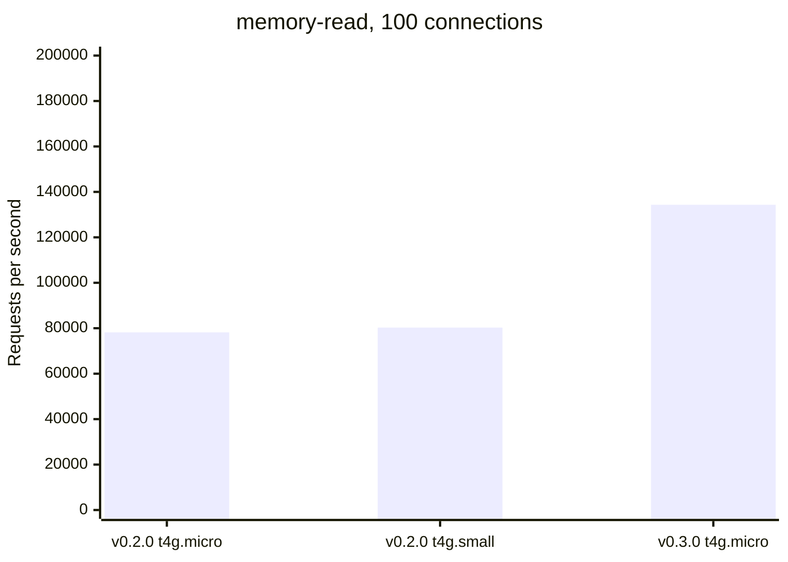
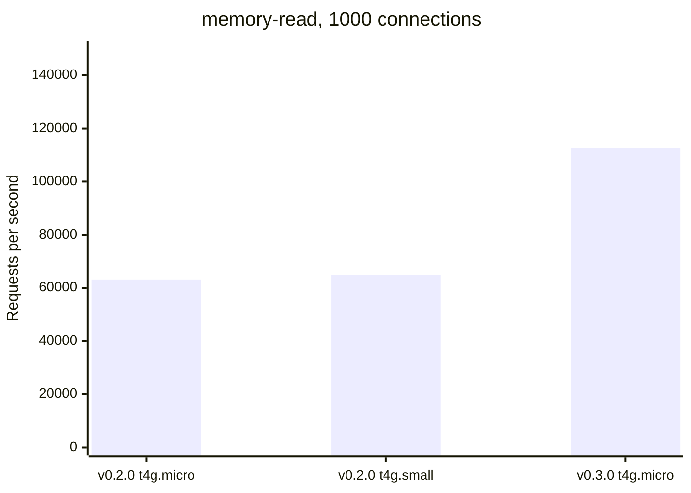
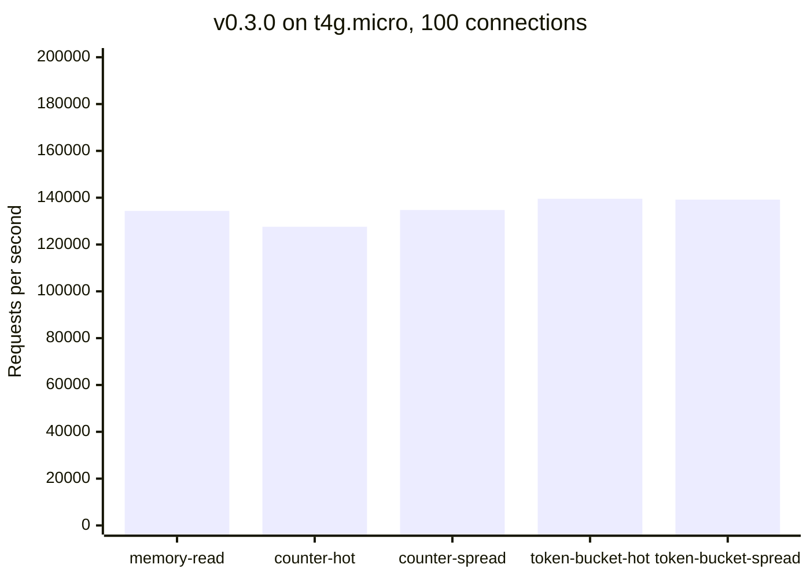
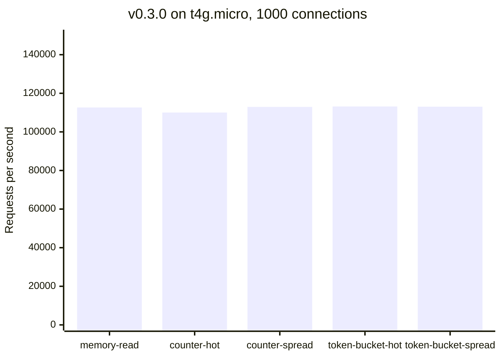

# Ghoti Benchmarks

Ghoti v0.3.0 answers 134,343 requests per second over 100 connections on a t4g.micro, 71.8% more than v0.2.0 on the same instance type.

All 39 of the 39 runs on EC2 were valid, with 0 errors over 524,263,392 validated requests. Every counter and token bucket run passed its correctness check.

These results were measured with [ghoti-bench](README.md) on AWS EC2 in `us-west-2`. The sections below show the results for each case, how to reproduce them and how they were obtained.

## Throughput

Closed loop: every connection has one request in flight, so throughput is what the server sustains at that concurrency. The charts show 100 and 1000 connections, where the server is the bottleneck. A single connection measures mostly the network round trip, see [Single connections](#single-connections); its numbers are in the table below.

### Memory reads by version and instance

memory-read, median of three 5 minute runs.





### Slot types on v0.3.0, t4g.micro

Memory reads are the median of three 5 minute runs, counters and token buckets one run of 30 seconds.





## Results for each case

One row per scenario, Ghoti version, server and connection count. Throughput and percentiles are the median of the valid repetitions, spread is half the range of throughput relative to the median, and max is the worst round trip of any repetition. Server CPU is relative to both cores of the server.

|Scenario |Ghoti |Server |Conns |Runs |Window s |req/s |Spread % |p50 ms |p99 ms |p99.9 ms |max ms |Server CPU % |Errors |Check |
|---|---|---|--:|--:|--:|--:|--:|--:|--:|--:|--:|--:|--:|---|
|memory-read |v0.2.0 |t4g.micro |1 |3 |300 |7,964 |2.3 |0.121 |0.196 |0.353 |7.486 |26.6 |0 |- |
|memory-read |v0.2.0 |t4g.micro |100 |3 |300 |78,185 |1.0 |1.026 |5.304 |8.684 |217.382 |96.2 |0 |- |
|memory-read |v0.2.0 |t4g.micro |1,000 |3 |300 |63,186 |0.5 |14.926 |33.243 |40.337 |240.178 |91.7 |0 |- |
|memory-read |v0.2.0 |t4g.small |1 |3 |300 |3,812 |0.8 |0.257 |0.332 |0.544 |10.577 |13.3 |0 |- |
|memory-read |v0.2.0 |t4g.small |100 |3 |300 |80,291 |0.3 |1.015 |5.095 |8.315 |27.378 |95.4 |0 |- |
|memory-read |v0.2.0 |t4g.small |1,000 |3 |300 |64,896 |0.1 |14.533 |32.670 |39.485 |258.661 |91.5 |0 |- |
|memory-read |v0.3.0 |t4g.micro |1 |3 |300 |3,359 |4.8 |0.290 |0.372 |0.597 |16.829 |6.1 |0 |- |
|memory-read |v0.3.0 |t4g.micro |100 |3 |300 |134,343 |1.7 |0.600 |3.541 |7.123 |57.185 |82.5 |0 |- |
|memory-read |v0.3.0 |t4g.micro |1,000 |3 |300 |112,647 |1.3 |8.376 |18.694 |26.231 |255.356 |89.3 |0 |- |
|counter-hot |v0.3.0 |t4g.micro |1 |1 |30 |3,453 |- |0.282 |0.368 |0.747 |9.754 |6.0 |0 |passed |
|counter-hot |v0.3.0 |t4g.micro |100 |1 |30 |127,594 |- |0.628 |4.053 |8.864 |74.566 |78.1 |0 |passed |
|counter-hot |v0.3.0 |t4g.micro |1,000 |1 |30 |110,026 |- |8.552 |19.300 |36.078 |71.779 |88.0 |0 |passed |
|counter-spread |v0.3.0 |t4g.micro |1 |1 |30 |3,320 |- |0.294 |0.369 |0.552 |5.697 |5.9 |0 |passed |
|counter-spread |v0.3.0 |t4g.micro |100 |1 |30 |134,746 |- |0.602 |3.494 |7.881 |51.752 |82.9 |0 |passed |
|counter-spread |v0.3.0 |t4g.micro |1,000 |1 |30 |112,955 |- |8.385 |17.990 |24.789 |32.151 |89.7 |0 |passed |
|token-bucket-hot |v0.3.0 |t4g.micro |1 |1 |30 |3,996 |- |0.242 |0.332 |0.681 |10.764 |6.9 |0 |passed |
|token-bucket-hot |v0.3.0 |t4g.micro |100 |1 |30 |139,552 |- |0.588 |3.379 |7.803 |65.059 |85.9 |0 |passed |
|token-bucket-hot |v0.3.0 |t4g.micro |1,000 |1 |30 |113,173 |- |8.339 |18.711 |26.329 |223.583 |89.3 |0 |passed |
|token-bucket-spread |v0.3.0 |t4g.micro |1 |1 |30 |3,957 |- |0.242 |0.368 |0.719 |8.952 |7.0 |0 |passed |
|token-bucket-spread |v0.3.0 |t4g.micro |100 |1 |30 |139,188 |- |0.591 |3.238 |7.520 |27.378 |86.3 |0 |passed |
|token-bucket-spread |v0.3.0 |t4g.micro |1,000 |1 |30 |113,062 |- |8.397 |17.842 |25.068 |222.237 |90.0 |0 |passed |

## Correctness checks

Counters and token buckets cannot be validated byte by byte, because their value changes on every read. After each run without errors the counters are read back and have to hold exactly the increments the generator validated, and every token bucket has to have granted at least its refills and never more than its size plus its refills over the length of the run.

|Run |Tokens in window |Check |What was checked |
|---|--:|---|---|
|counter-hot-c1-r1 |- |passed |counter matched all 120912 increments |
|counter-hot-c100-r1 |- |passed |counter matched all 4514037 increments |
|counter-hot-c1000-r1 |- |passed |counter matched all 3850751 increments |
|counter-spread-c1-r1 |- |passed |counter matched all 116246 increments |
|counter-spread-c100-r1 |- |passed |counter matched all 4716734 increments |
|counter-spread-c1000-r1 |- |passed |counter matched all 3956127 increments |
|token-bucket-hot-c1-r1 |29,977 |passed |36270 tokens in 35.0s with 33000 to 38000 allowed per slot |
|token-bucket-hot-c100-r1 |30,000 |passed |36999 tokens in 35.0s with 33000 to 38000 allowed per slot |
|token-bucket-hot-c1000-r1 |30,000 |passed |36999 tokens in 35.0s with 33000 to 38000 allowed per slot |
|token-bucket-spread-c1-r1 |29,988 |passed |36875 tokens in 35.0s with 330 to 380 allowed per slot |
|token-bucket-spread-c100-r1 |30,000 |passed |36900 tokens in 35.0s with 330 to 380 allowed per slot |
|token-bucket-spread-c1000-r1 |30,000 |passed |36900 tokens in 35.0s with 330 to 380 allowed per slot |

## How to reproduce

1. Install the AWS CLI v2 with credentials for an account that has a default VPC in the region, plus Go, ssh, scp and curl.
2. Clone ghoti-bench and run the commands below from its root.
3. Run the command of the session you want to repeat. The script creates both instances, runs the benchmark, downloads everything to `results/ec2-<timestamp>/` and deletes every resource it created, also when it fails. A full memory matrix takes about an hour, the 30 second slot runs a few minutes each.
4. Compare your `summary.csv` with the table above. Single connection numbers depend on the network between the two instances you get, see [Single connections](#single-connections).

`scripts/ec2-token-bucket-bench.sh` is still in an open pull request and only exists on its branch until it merges. To try a scenario on your own machine, `ghoti-bench run --ghoti-ref v0.3.0 --scenario counter-hot` starts the server itself, but numbers from one host are only good for comparing commits.

### v0.2.0 on t4g.micro

```sh
AWS_REGION=us-west-2 GHOTI_REF=v0.2.0 scripts/ec2-bench.sh
```

|Setting |Value |
|---|---|
|Ghoti |v0.2.0 |
|Server |t4g.micro arm64 |
|Generator |c7g.xlarge |
|Region |us-west-2 |
|Runs |9: 3 × 300s after 30s warm-up |
|ghoti-bench |Unmerged build of the EC2 script |

### v0.2.0 on t4g.small

```sh
AWS_REGION=us-west-2 GHOTI_REF=v0.2.0 SERVER_TYPE=t4g.small scripts/ec2-bench.sh
```

|Setting |Value |
|---|---|
|Ghoti |v0.2.0 |
|Server |t4g.small arm64 |
|Generator |c7g.xlarge |
|Region |us-west-2 |
|Runs |9: 3 × 300s after 30s warm-up |
|ghoti-bench |Unmerged build of the EC2 script |

### v0.3.0 on t4g.micro

```sh
AWS_REGION=us-west-2 GHOTI_REF=v0.3.0 scripts/ec2-bench.sh
```

|Setting |Value |
|---|---|
|Ghoti |v0.3.0 |
|Server |t4g.micro arm64 |
|Generator |c7g.xlarge |
|Region |us-west-2 |
|Runs |9: 3 × 300s after 30s warm-up |
|ghoti-bench |Unmerged build of the EC2 script |

### Counters on v0.3.0 t4g.micro

```sh
AWS_REGION=us-west-2 GHOTI_REF=v0.3.0 scripts/ec2-counter-bench.sh --repetitions 1 --warmup 5s --duration 30s
```

|Setting |Value |
|---|---|
|Ghoti |v0.3.0 |
|Server |t4g.micro arm64 |
|Generator |c7g.xlarge |
|Region |us-west-2 |
|Runs |6: 1 × 30s after 5s warm-up |
|ghoti-bench |Unmerged build of the counter benchmark |

### Token buckets on v0.3.0 t4g.micro

```sh
AWS_REGION=us-west-2 GHOTI_REF=v0.3.0 scripts/ec2-token-bucket-bench.sh --repetitions 1 --warmup 5s --duration 30s
```

|Setting |Value |
|---|---|
|Ghoti |v0.3.0 |
|Server |t4g.micro arm64 |
|Generator |c7g.xlarge |
|Region |us-west-2 |
|Runs |6: 1 × 30s after 5s warm-up |
|ghoti-bench |Unmerged build of the token bucket benchmark |

## How the results were obtained

### Hosts

Two EC2 instances in the same subnet of one availability zone, on Amazon Linux 2023. The server is a t4g.micro (2 Graviton2 Neoverse-N1 cores, 1 GiB), or a t4g.small where the table says so, with unlimited CPU credits so it is never throttled during a run. The load generator is a c7g.xlarge (4 Graviton3 cores), much bigger than the server so the generator is not what is being measured.

### Server

The released Ghoti binary for linux/arm64, checked against the release checksums, runs as a systemd unit with log level warn and metrics enabled. It has simple memory slots 000-099, plus atomic counters 100-199 and token buckets 200 and 300-399 in the sessions that ran them. The scripts now generate this configuration with `ghoti-bench server-config`.

### Load

Every connection is opened before the run and stays open. Each one sends a request, waits for the whole response, validates it and only then sends the next. Requests and expected responses are prebuilt, so the generator does no per-request work beyond the round trip. A warm-up runs first and is not measured. Latency goes into an HDR histogram with 3 significant digits, the max is exact.

### Validity

A run only counts if every connection was established and reported by the server for the whole measurement, there were no errors at all, warm-up included, the correctness check passed, and the generator CPU stayed under 80%. The highest generator CPU of any run here was 42.2%.

### Single connections

With one connection the server is idle most of the time and the result is the network round trip. The same instance types ran v0.2.0 at 7,964 req/s (p50 0.121 ms) in one session and v0.3.0 at 3,359 req/s (p50 0.290 ms) in another. The gap most likely comes from the network path between the two instances each session got, not from Ghoti, so compare versions at 100 and 1000 connections.

### Short slot runs

The counter and token bucket results are one run of 30 seconds after a 5 second warm-up, enough to compare slot types but with no repetitions to show their spread. The memory results are three runs of 5 minutes after a 30 second warm-up. Each session used a ghoti-bench build that had not been merged yet, listed under each command above.
