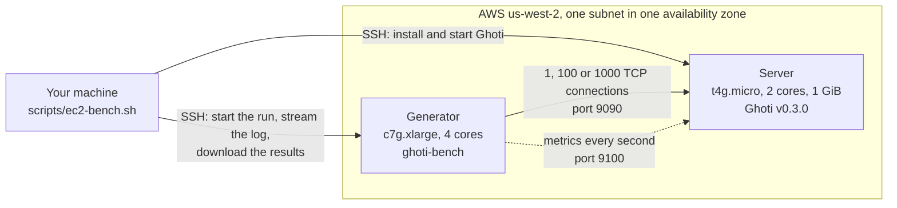

# Ghoti Benchmarks

These are the results of benchmarking Ghoti v0.3.0 on AWS EC2 with [ghoti-bench](README.md). Ghoti ran on a t4g.micro, a small Graviton instance with 2 cores and 1 GiB of memory, and answered most requests in well under a millisecond. Every number on this page can be reproduced with the commands in [How to reproduce](#how-to-reproduce).

## Summary

- **Sub-millisecond answers.** With one connection, 99.9% of the requests of every slot type got their answer in less than 0.75 ms, measured on the client and including the network between the two instances. Half of them took less than 0.29 ms.
- **Still sub-millisecond under load.** With 100 connections Ghoti served 134,343 requests per second and half of the requests got their answer in less than 0.60 ms, for every slot type (the slowest median was 0.628 ms).
- **Microseconds inside the server.** Ghoti's own metrics show an average of 7.6 µs per request over 247,423,099 memory reads, with 99.8% of them taking less than 50 µs and 99.97% less than a millisecond.
- **Every slot type is as fast.** Atomic counters and token buckets answer as fast as plain memory reads, even when every connection uses the same slot.
- **Every answer was right.** All 21 runs finished with 0 errors over 255,244,437 requests, and every counter and token bucket gave exactly the answers they had to.

## How the setup works

Every session uses two EC2 instances that `scripts/ec2-bench.sh` creates for it and deletes when it is done. Ghoti runs alone on the small one. ghoti-bench, the load generator, runs on a much bigger one, so that the generator never runs out of CPU and the numbers are about Ghoti.



A session goes like this:

1. **Build.** The script builds ghoti-bench for the generator and downloads the released Ghoti binary for the server, checked against the release checksums.
2. **Launch.** It creates both instances in the same subnet, with a temporary key pair and a firewall that only lets your machine in over SSH and only lets the generator reach Ghoti. Keeping both in one zone means the network between them is as short as EC2 offers.
3. **Start Ghoti.** Ghoti starts on the server with the slots every scenario needs and its Prometheus metrics enabled.
4. **Run the matrix.** On the generator, ghoti-bench runs each scenario with 1, 100 and 1000 connections. Every connection is opened first and stays open. Each one sends a request, waits for the whole answer, checks it and only then sends the next one, so a connection never has more than one request in flight. A warm-up runs before every measurement and is not counted.
5. **Measure both sides.** The generator times every round trip, from sending a request until its whole answer is back, which includes the network. Every second it also reads Ghoti's metrics for the server CPU, memory and connected clients. Ghoti times every request it handles too, and those times are in the metrics the script downloads at the end.
6. **Collect and clean up.** The script downloads the results, Ghoti's log and the final metrics to your machine, then deletes both instances, the key pair and the firewall, also when the run fails.

## What was measured

Each connection waits for the answer to its request before it sends the next one, so the benchmark measures both how many requests per second Ghoti sustains and how long each request takes.

|Scenario |What every request does |Runs |
|---|---|---|
|memory-read |Reads a 36 byte value from a simple memory slot. |3 runs of 5 minutes |
|counter-hot |Increments one atomic counter that every connection shares. |1 run of 30 seconds |
|counter-spread |Increments one of 100 atomic counters, chosen at random. |1 run of 30 seconds |
|token-bucket-hot |Takes a token from one token bucket that every connection shares, 1,000 tokens per second. |1 run of 30 seconds |
|token-bucket-spread |Takes a token from one of 100 token buckets, chosen at random, 10 tokens per second each. |1 run of 30 seconds |

Latency is given as percentiles: p50 is the time half of the requests stay under, p99 the time 99% of them stay under, and p99.9 the time all but one in a thousand stay under.

## Latency with one connection

With one connection Ghoti answers each request as soon as it arrives, so this is the fastest a client can get an answer. The times are measured on the client and include the network round trip between the two instances.

```text
Round trip, p50, 1 connection. A full bar is 1 ms.

memory-read          █████████▎                        0.290 ms
counter-hot          █████████                         0.282 ms
counter-spread       █████████▍                        0.294 ms
token-bucket-hot     ███████▊                          0.242 ms
token-bucket-spread  ███████▊                          0.242 ms
```

```text
Round trip, p99.9, 1 connection. A full bar is 1 ms.

memory-read          ███████████████████▏              0.597 ms
counter-hot          ███████████████████████▉          0.747 ms
counter-spread       █████████████████▋                0.552 ms
token-bucket-hot     █████████████████████▊            0.681 ms
token-bucket-spread  ███████████████████████           0.719 ms
```

|Scenario |p50 ms |p90 ms |p99 ms |p99.9 ms |
|---|--:|--:|--:|--:|
|memory-read |0.290 |0.322 |0.372 |0.597 |
|counter-hot |0.282 |0.309 |0.368 |0.747 |
|counter-spread |0.294 |0.321 |0.369 |0.552 |
|token-bucket-hot |0.242 |0.274 |0.332 |0.681 |
|token-bucket-spread |0.242 |0.286 |0.368 |0.719 |

## Latency under load

With 100 connections Ghoti serves over a hundred thousand requests per second and the median answer still comes back in about 0.6 ms. The slowest requests take a few milliseconds, because with 100 clients sending at full speed some requests have to wait for others to be answered first.

```text
Round trip, p50, 100 connections. A full bar is 1 ms.

memory-read          ███████████████████▎              0.600 ms
counter-hot          ████████████████████▏             0.628 ms
counter-spread       ███████████████████▎              0.602 ms
token-bucket-hot     ██████████████████▉               0.588 ms
token-bucket-spread  ██████████████████▉               0.591 ms
```

|Scenario |Requests per second |p50 ms |p90 ms |p99 ms |p99.9 ms |Server CPU |
|---|--:|--:|--:|--:|--:|--:|
|memory-read |134,343 |0.600 |1.101 |3.541 |7.123 |82% |
|counter-hot |127,594 |0.628 |1.168 |4.053 |8.864 |78% |
|counter-spread |134,746 |0.602 |1.092 |3.494 |7.881 |83% |
|token-bucket-hot |139,552 |0.588 |1.075 |3.379 |7.803 |86% |
|token-bucket-spread |139,188 |0.591 |1.081 |3.238 |7.520 |86% |

## Time inside Ghoti

Ghoti measures every request itself, from the moment it has the complete request until the answer is written to the connection. That leaves out the network and the client, so it shows how much of the round trip is Ghoti. The numbers cover every request of each session, warm-ups and every connection count included.

|Session |Requests |Average |Under 50 µs |Under 100 µs |Under 250 µs |Under 1 ms |
|---|--:|--:|--:|--:|--:|--:|
|Memory reads |247,423,099 |7.6 µs |99.83% |99.93% |99.95% |99.97% |
|Counters |17,275,413 |11.6 µs |99.64% |99.82% |99.86% |99.91% |
|Token buckets |17,976,490 |11.2 µs |99.65% |99.84% |99.88% |99.92% |

Almost all of a sub-millisecond round trip is the network, the operating systems and the client. Ghoti itself spends a few microseconds on each request.

## Many connections

With 1000 connections the round trip is no longer under a millisecond: the median is 8.4 ms. Ghoti is not slower per request, it is busy. The server uses 89% of its 2 cores and serves 112,647 requests per second, so 1000 clients that each keep one request waiting share that rate. Each one waits about 1000 / 112,647 = 8.9 ms for its turn, which matches the measured average of 8.9 ms.

Ghoti's own time stays in microseconds through these runs too. They are almost half of the requests of the memory session, and 99.8% of all its requests took less than 50 µs, so nearly all of the 1000 connection requests did as well. What grows is the time each request waits for its turn. With fewer clients waiting at once, as with 100 connections, the median answer comes back in under a millisecond on this same 2 core instance.

## Throughput

Requests per second each slot type sustained. memory-read is the median of three runs, the other slot types one run each, so differences of a few percent between them are within what one run can show.

```text
100 connections

memory-read          ██████████████████████████████▊   134,343 req/s
counter-hot          █████████████████████████████▎    127,594 req/s
counter-spread       ██████████████████████████████▉   134,746 req/s
token-bucket-hot     ████████████████████████████████  139,552 req/s
token-bucket-spread  ███████████████████████████████▉  139,188 req/s
```

```text
1,000 connections

memory-read          ███████████████████████████████▉  112,647 req/s
counter-hot          ███████████████████████████████▏  110,026 req/s
counter-spread       ████████████████████████████████  112,955 req/s
token-bucket-hot     ████████████████████████████████  113,173 req/s
token-bucket-spread  ████████████████████████████████  113,062 req/s
```

## Correctness checks

A fast answer only counts if it is right. Every memory read is compared byte by byte with the value the slot holds. The value of a counter or a token bucket changes on every request, so those are checked after the run:

- **Counters** are read back once the run is over. A counter has to hold exactly the number of increments the benchmark counted, otherwise some were lost or applied twice.
- **Token buckets** have to hand out every token they refill while the load keeps them empty, and never more than they can hold plus their refills.

|Scenario |Connections |Result |
|---|--:|---|
|counter-hot |1 |Passed. The counter matched all 120,912 increments. |
|counter-hot |100 |Passed. The counter matched all 4,514,037 increments. |
|counter-hot |1,000 |Passed. The counter matched all 3,850,751 increments. |
|counter-spread |1 |Passed. The counter matched all 116,246 increments. |
|counter-spread |100 |Passed. The counter matched all 4,716,734 increments. |
|counter-spread |1,000 |Passed. The counter matched all 3,956,127 increments. |
|token-bucket-hot |1 |Passed. 29,977 tokens in the 30 second window. Over the whole 35 second run the bucket handed out 36,270 tokens, with 33,000 to 38,000 allowed. |
|token-bucket-hot |100 |Passed. 30,000 tokens in the 30 second window. Over the whole 35 second run the bucket handed out 36,999 tokens, with 33,000 to 38,000 allowed. |
|token-bucket-hot |1,000 |Passed. 30,000 tokens in the 30 second window. Over the whole 35 second run the bucket handed out 36,999 tokens, with 33,000 to 38,000 allowed. |
|token-bucket-spread |1 |Passed. 29,988 tokens in the 30 second window. Over the whole 35 second run the 100 buckets handed out 36,875 tokens, with 330 to 380 allowed for each one. |
|token-bucket-spread |100 |Passed. 30,000 tokens in the 30 second window. Over the whole 35 second run the 100 buckets handed out 36,900 tokens, with 330 to 380 allowed for each one. |
|token-bucket-spread |1,000 |Passed. 30,000 tokens in the 30 second window. Over the whole 35 second run the 100 buckets handed out 36,900 tokens, with 330 to 380 allowed for each one. |

## How to reproduce

1. Install the AWS CLI v2 with credentials for an account that has a default VPC in the region, plus Go, ssh, scp and curl.
2. Clone ghoti-bench and run the command of the session you want to repeat from its root.
3. The script creates both instances, runs the benchmark, downloads everything to `results/ec2-<timestamp>/` and deletes every resource it created, also when it fails. The memory session takes about an hour, the counter and token bucket sessions a few minutes each.
4. Compare your `summary.csv` with [All results](#all-results). The time inside Ghoti is in `server/metrics-final.txt`, under `ghoti_request_duration_seconds`.

|Session |Command |
|---|---|
|Memory reads |`AWS_REGION=us-west-2 GHOTI_REF=v0.3.0 scripts/ec2-bench.sh` |
|Counters |`AWS_REGION=us-west-2 GHOTI_REF=v0.3.0 scripts/ec2-counter-bench.sh --repetitions 1 --warmup 5s --duration 30s` |
|Token buckets |`AWS_REGION=us-west-2 GHOTI_REF=v0.3.0 scripts/ec2-token-bucket-bench.sh --repetitions 1 --warmup 5s --duration 30s` |

The memory session runs three repetitions of 5 minutes after a 30 second warm-up, the other two one run of 30 seconds after a 5 second warm-up. Each session used a build of ghoti-bench from before its scripts were merged, so a run from `main` can differ slightly.

Latency with one connection depends on the network between the two instances you get, so expect a different round trip than the one here. The time inside Ghoti does not depend on it.

## How the results were obtained

- **Hosts.** Two instances in the same subnet of one availability zone in us-west-2, on Amazon Linux 2023. The server is a t4g.micro (2 Graviton2 cores, 1 GiB) with unlimited CPU credits so it is never throttled. The load comes from a c7g.xlarge (4 Graviton3 cores), much bigger than the server so the benchmark is not what is being measured.
- **Server.** The released Ghoti v0.3.0 binary for linux/arm64, checked against the release checksums, with log level warn and metrics enabled. It has simple memory slots 000-099, and atomic counters 100-199 and token buckets 200 and 300-399 in the sessions that used them.
- **Load.** Every connection is opened before the run and stays open. Requests and their expected answers are prepared before the run, so the benchmark does no work per request beyond sending it and checking the answer. A warm-up runs first and is not measured.
- **Latency.** Every round trip is recorded on the client in a histogram with 3 significant digits. The maximum is exact. The time inside Ghoti comes from Ghoti's Prometheus histogram, whose buckets start at 50 µs.
- **Validity.** A run only counts if every connection stayed open for the whole run, there were no errors at all, the correctness checks passed and the benchmark used less than 80% of its CPU.

## All results

Ghoti v0.3.0 on a t4g.micro. The median of the valid runs for every case. Max is the slowest round trip of any run.

|Scenario |Connections |Runs |Requests per second |p50 ms |p90 ms |p99 ms |p99.9 ms |max ms |Server CPU |Errors |
|---|--:|--:|--:|--:|--:|--:|--:|--:|--:|--:|
|memory-read |1 |3 |3,359 |0.290 |0.322 |0.372 |0.597 |16.829 |6% |0 |
|memory-read |100 |3 |134,343 |0.600 |1.101 |3.541 |7.123 |57.185 |82% |0 |
|memory-read |1,000 |3 |112,647 |8.376 |11.190 |18.694 |26.231 |255.356 |89% |0 |
|counter-hot |1 |1 |3,453 |0.282 |0.309 |0.368 |0.747 |9.754 |6% |0 |
|counter-hot |100 |1 |127,594 |0.628 |1.168 |4.053 |8.864 |74.566 |78% |0 |
|counter-hot |1,000 |1 |110,026 |8.552 |11.502 |19.300 |36.078 |71.779 |88% |0 |
|counter-spread |1 |1 |3,320 |0.294 |0.321 |0.369 |0.552 |5.697 |6% |0 |
|counter-spread |100 |1 |134,746 |0.602 |1.092 |3.494 |7.881 |51.752 |83% |0 |
|counter-spread |1,000 |1 |112,955 |8.385 |11.133 |17.990 |24.789 |32.151 |90% |0 |
|token-bucket-hot |1 |1 |3,996 |0.242 |0.274 |0.332 |0.681 |10.764 |7% |0 |
|token-bucket-hot |100 |1 |139,552 |0.588 |1.075 |3.379 |7.803 |65.059 |86% |0 |
|token-bucket-hot |1,000 |1 |113,173 |8.339 |11.174 |18.711 |26.329 |223.583 |89% |0 |
|token-bucket-spread |1 |1 |3,957 |0.242 |0.286 |0.368 |0.719 |8.952 |7% |0 |
|token-bucket-spread |100 |1 |139,188 |0.591 |1.081 |3.238 |7.520 |27.378 |86% |0 |
|token-bucket-spread |1,000 |1 |113,062 |8.397 |11.035 |17.842 |25.068 |222.237 |90% |0 |
